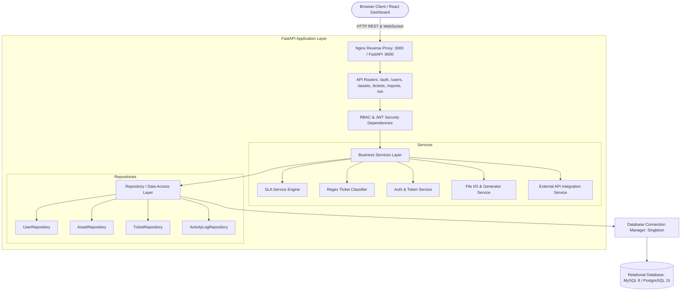
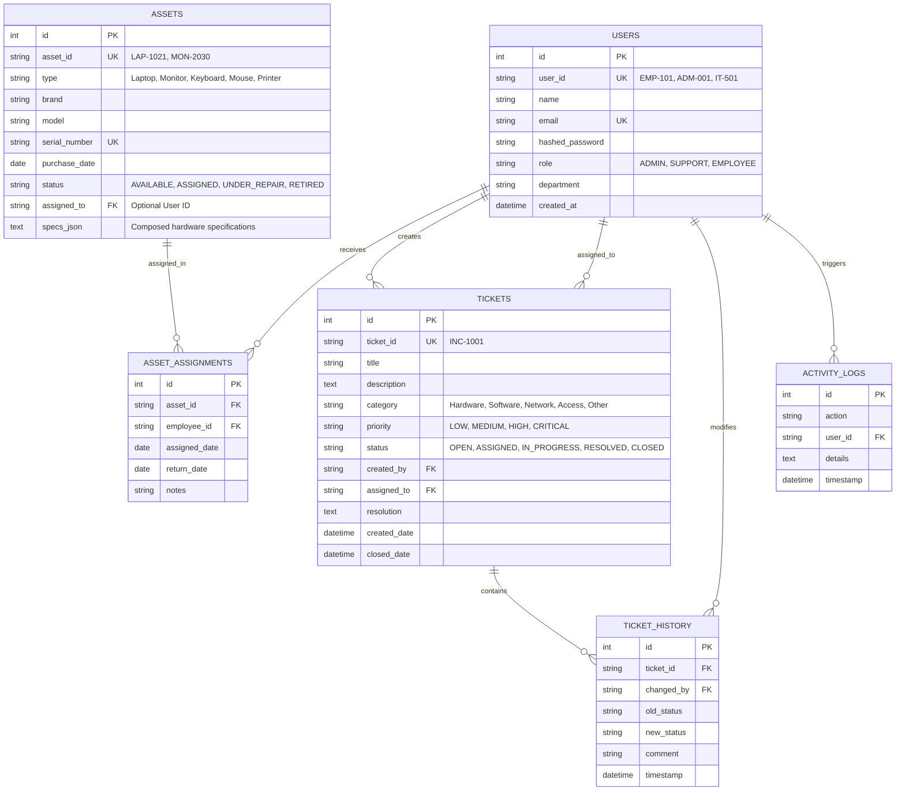

# Smart IT Asset & Support Ticket Management System

[](https://www.python.org/)
[](https://fastapi.tiangolo.com/)
[](https://www.sqlalchemy.org/)
[]()
[]()
[](https://www.docker.com/)

An enterprise-grade, production-style **IT Asset Management and Support Ticket Management System** developed with **Python, FastAPI, SQLAlchemy 2, Alembic, MySQL/PostgreSQL, WebSockets, and a React 18 Single Page Application (SPA)**.

---

## 📌 Table of Contents
1. [Project Overview](#-project-overview)
2. [Technology Stack](#-technology-stack)
3. [System Architecture](#-system-architecture)
4. [Database Design & ER Diagram](#-database-design--er-diagram)
5. [Database Dialects & Environment Profiles](#-database-dialects--environment-profiles)
6. [Core Features & Modules](#-core-features--modules)
7. [Advanced Python Concepts Demonstrated](#-advanced-python-concepts-demonstrated)
8. [Docker & Containerization](#-docker--containerization)
9. [Local Setup & Run Instructions](#-local-setup--run-instructions)
10. [Automated Testing & Code Quality](#-automated-testing--code-quality)
11. [API Endpoints Reference](#-api-endpoints-reference)
12. [Comprehensive College Viva Guide](#-comprehensive-college-viva-guide)

---

## 📖 Project Overview

Organizations require seamless management of physical hardware assets (laptops, monitors, keyboards, mice, printers) and structured support ticket workflows for employee issue resolution. 

This system provides:
- **Role-Based Access Control (RBAC)** across three distinct personas: **Admin**, **IT Support**, and **Employee**.
- **Hardware Asset Lifecycle Tracking**: `AVAILABLE` → `ASSIGNED` → `UNDER_REPAIR` → `RETIRED` with hardware specifications and serial number encapsulation.
- **Automated Ticket Classification**: Regex-based auto-categorization into `Hardware`, `Software`, `Network`, `Access`, or `Other`, with dynamic priority assignment (`LOW`, `MEDIUM`, `HIGH`, `CRITICAL`).
- **SLA Tracking Engine**: Strict resolution deadlines (Critical: 2h/4h, High: 4h/8h, Medium: 8h/24h, Low: 24h/48h) with real-time breach detection.
- **Real-Time Live Updates via WebSockets**: Instant dashboard notification broadcasts when tickets are opened, assigned, or resolved.
- **Production Readiness**: Alembic migrations, multi-profile configurations (`.env.dev`, `.env.qa`, `.env.prod`), Docker Compose orchestration, and Pylint 10.00/10 code quality.

---

## 🛠 Technology Stack

| Layer | Technologies Used |
| :--- | :--- |
| **Backend Framework** | Python 3.11 / 3.12, FastAPI, Uvicorn, Starlette |
| **Validation & Schemas**| Pydantic v2, Pydantic Settings, Email-Validator |
| **ORM & Database** | SQLAlchemy 2.0 (Repository & Singleton Pattern), Alembic (Migrations) |
| **Database Engines** | MySQL 8.0 (PyMySQL), PostgreSQL 15 (psycopg2-binary), SQLite 3 |
| **Authentication** | OAuth2 Bearer, PyJWT (HMAC-SHA256), Passlib (Bcrypt hashing) |
| **Real-Time & Networking** | FastAPI WebSockets, Python `requests` (External API integration) |
| **Frontend** | React 18, Babel Standalone (No Node.js build dependencies required), Vanilla CSS |
| **Containerization** | Docker, Docker Compose, Nginx Alpine Reverse Proxy |
| **Testing & Quality** | Pytest, Pytest-Asyncio, Pylint (Score: 10.00/10), SonarLint |

---

## 🏗 System Architecture

The application implements a strict **Layered MVC / Clean Architecture**:



---

## 🗄 Database Design & ER Diagram

The database enforces **ACID** properties with foreign key constraints, primary keys, and unique indexes:



---

## ⚙️ Database Dialects & Environment Profiles

The project implements a decoupled connection manager [`app/database/connection.py`](file:///c:/Users/Yash/OneDrive/Desktop/CAPSTONE%20PROJECT/app/database/connection.py) adhering to the **Singleton Pattern**:

1. **Development (`.env.dev` / `.env`)**: Configured for local **MySQL 8.0** (`localhost:3306`), accessible via **DBeaver** or MySQL Workbench. Also supports zero-setup **SQLite** for standalone testing.
2. **QA / Staging (`.env.qa`)**: Configured for **PostgreSQL 15** integration testing.
3. **Production (`.env.prod`)**: Hardened settings for containerized deployment with strict token expiry and warning-level logging.

> **Professor / Viva Note**: The codebase is database-agnostic. By changing `DB_TYPE=mysql` to `DB_TYPE=postgres` in the configuration, SQLAlchemy automatically switches dialects without requiring a single code modification.

### Running Database Migrations (Alembic)
```powershell
# View current database revision
alembic current

# Run forward migrations to latest schema
alembic upgrade head

# Generate a new migration revision
alembic revision --autogenerate -m "Add new column"
```

---

## 🔑 Core Features & Modules

### 1. Role-Based Access Control (RBAC)
- **Admin**: Full authority to create users, register hardware assets, reassign tickets, adjust SLA priorities, and view enterprise audit reports.
- **IT Support**: View tickets assigned to IT queues, update ticket status (`IN_PROGRESS`, `RESOLVED`), append resolution remarks, and monitor approaching SLA breaches.
- **Employee**: Authenticate, view personal profile and assigned company assets, raise new tickets with automated classification, and track resolution progress.

### 2. Automatic Ticket Classification Engine
Located in [`app/services/ticket_classifier.py`](file:///c:/Users/Yash/OneDrive/Desktop/CAPSTONE%20PROJECT/app/services/ticket_classifier.py):
- Uses compiled **regular expressions** and keyword scoring dictionaries.
- Detects category (`Hardware`, `Software`, `Network`, `Access`, `Other`) from ticket title and description.
- Automatically flags emergency keywords (`down`, `crash`, `fire`, `urgent`, `bsod`, `ransomware`) to escalate ticket priority to `CRITICAL` or `HIGH`.

### 3. SLA Calculation & Breach Engine
Located in [`app/services/sla_service.py`](file:///c:/Users/Yash/OneDrive/Desktop/CAPSTONE%20PROJECT/app/services/sla_service.py):
- Computes deadlines: `CRITICAL` (4 hrs), `HIGH` (8 hrs), `MEDIUM` (24 hrs), `LOW` (48 hrs).
- Tracks live status: `WITHIN_SLA`, `APPROACHING_BREACH` (<20% remaining), or `BREACHED`.
- Generates SLA compliance metrics (% in-SLA, average resolution turnaround minutes).

### 4. Real-Time WebSockets
Located in [`app/main.py`](file:///c:/Users/Yash/OneDrive/Desktop/CAPSTONE%20PROJECT/app/main.py):
- Dedicated route `/ws/tickets` using the `WebSocketNotificationManager`.
- Whenever an asset is reassigned or a ticket is created/resolved, live JSON payloads are broadcast to connected client dashboards without HTTP polling.

### 5. External API Integration
Located in [`app/api/reports.py`](file:///c:/Users/Yash/OneDrive/Desktop/CAPSTONE%20PROJECT/app/api/reports.py):
- Uses Python `requests` with explicit connection and read timeouts (5s).
- Implements robust exception handling for `requests.exceptions.Timeout`, `ConnectionError`, and non-200 HTTP responses with reliable fallback telemetry.

---

## 🐍 Advanced Python Concepts Demonstrated

The codebase was crafted specifically to satisfy all advanced Python internship requirements:

1. **Object-Oriented Programming & Hierarchy** ([`app/models/asset.py`](file:///c:/Users/Yash/OneDrive/Desktop/CAPSTONE%20PROJECT/app/models/asset.py)):
   - Base `Asset` class with polymorphic subclasses: `Laptop`, `Monitor`, `Keyboard`, `Mouse`, `Printer`.
   - **Encapsulation**: `@property` getter/setter for serial numbers with format validation.
   - **Composition**: `HardwareSpecs` dataclass (`ram_gb`, `processor`, `storage_gb`) composed within `Laptop`.
2. **Generators & Memory Efficiency** ([`app/utils/generators.py`](file:///c:/Users/Yash/OneDrive/Desktop/CAPSTONE%20PROJECT/app/utils/generators.py)):
   - `yield` generator streams to process 10,000+ ticket records in chunked batches without exhausting server RAM.
3. **Custom Decorators** ([`app/utils/decorators.py`](file:///c:/Users/Yash/OneDrive/Desktop/CAPSTONE%20PROJECT/app/utils/decorators.py)):
   - `@log_execution_time`: Benchmarks millisecond runtime latency of sensitive algorithms.
   - `@require_roles_decorator`: Server-side authorization barrier.
4. **Custom Domain Exceptions** ([`app/utils/exceptions.py`](file:///c:/Users/Yash/OneDrive/Desktop/CAPSTONE%20PROJECT/app/utils/exceptions.py)):
   - `InvalidAssetError`, `InvalidStatusTransitionError`, `TicketNotFoundError`, `SLABreachError`, `DatabaseConnectionError`.
   - Handled globally by FastAPI with uniform JSON error structures.
5. **SOLID Principles**:
   - **S**: Single Responsibility per module (API routes handle requests; Services handle business logic; Repositories handle database persistence).
   - **O**: Open/Closed principle in `Asset` hierarchy (new asset types inherit base behavior without modifying existing classes).
   - **L**: Liskov Substitution (subclasses can replace parent `Asset` everywhere).
   - **I**: Interface Segregation (clean Pydantic request vs response schemas).
   - **D**: Dependency Inversion (FastAPI `Depends` injections for sessions and users).

---

## 🐳 Docker & Containerization

The project includes multi-service orchestration via [`docker-compose.yml`](file:///c:/Users/Yash/OneDrive/Desktop/CAPSTONE%20PROJECT/docker-compose.yml):

```
┌─────────────────────────────────────────────────────────────┐
│                      Docker Network                         │
│                                                             │
│  [Frontend Nginx :3000] ──> [FastAPI Backend :8000] ──> [DB: MySQL 8 :3306]
│  (Static React SPA)         (Uvicorn REST & WS)         (Persistent Volume)
└─────────────────────────────────────────────────────────────┘
```

### Running with Docker Compose:
```bash
# Build and launch all three containers in background
docker-compose up -d --build

# View real-time container logs
docker-compose logs -f backend

# Stop all containers safely
docker-compose down
```

---

## 🚀 Local Setup & Run Instructions

### 1. Prerequisites
- Python 3.11 or 3.12
- MySQL 8.0 running locally (or SQLite fallback)

### 2. Environment Configuration
Copy `.env.example` to create your local `.env`:
```powershell
cp .env.example .env
```
Ensure you provide a strong `JWT_SECRET_KEY` (at least 32 characters in production) and configure your database connection string.

### 3. Activate Virtual Environment & Install Dependencies
```powershell
# In project root
.\.venv\Scripts\Activate.ps1

# Install requirements
pip install -r requirements.txt
```

### 4. Database Schema Migrations (Alembic)
Run Alembic migrations to apply all schema updates (including user status, invitation tokens, and foreign keys):
```powershell
alembic upgrade head
```

### 5. Secure Admin Account Bootstrap
To create an initial Administrator account safely with cryptographically hashed passwords and audit logging:
```powershell
python scripts/bootstrap_admin.py --user-id ADM-999 --name "System Administrator" --email admin@enterprise.local --department "IT Operations"
```
*(You will be prompted for an admin password securely without echo).*

### 6. Launch the Backend Server
```powershell
uvicorn app.main:app --reload --host 127.0.0.1 --port 8000
```

### 7. Access the Application
- **Interactive Web Dashboard**: [http://127.0.0.1:8000/](http://127.0.0.1:8000/)
- **Swagger Interactive API Documentation**: [http://127.0.0.1:8000/docs](http://127.0.0.1:8000/docs)
- **ReDoc API Documentation**: [http://127.0.0.1:8000/redoc](http://127.0.0.1:8000/redoc)
- **Health Check**: [http://127.0.0.1:8000/health](http://127.0.0.1:8000/health)

### 8. Employee Registration Workflow
1. **Admin Invites Employee** (`POST /users/`):
   - Admin provides `user_id`, `name`, `email`, `department`, `role` (`EMPLOYEE` or `SUPPORT`).
   - Account is created in `PENDING` status with an unguessable, cryptographically secure invitation token valid for 48 hours (stored as a SHA-256 hash).
   - In development, the single-use invitation token is returned in the response for delivery (`invitation_token`).
2. **Employee Verifies Invitation** (`GET /auth/verify-invitation?token=<TOKEN>`):
   - Validates the token exists, is not expired, and account is `PENDING`. Returns employee ID and name.
3. **Employee Completes Registration** (`POST /auth/complete-registration`):
   - Employee submits `token`, `name`, `password` (minimum 8 characters).
   - Password is salted and hashed with bcrypt; `status` transitions to `ACTIVE`; token hash is cleared (single-use).
4. **Employee Logs In** (`POST /auth/login`):
   - Returns Bearer JWT with claims (`sub`, `role`, `status`).

---

## 🧪 Automated Testing & Code Quality

### 1. Running Pytest Suite
```powershell
pytest tests/ -v
```
**Results**: **59 passed** (100% pass rate in ~9.5s), covering:
- **Authentication & Registration** (`test_auth_registration.py`): Login success/rejection, elimination of placeholder password bypass, pending/disabled account rejection, single-use invitation lifecycle, invitation expiry.
- **RBAC & Resource Security** (`test_rbac_and_resources.py`): Unauthorized endpoint rejection, IDOR prevention on assets and tickets, support-only assignments, ticket closure rules.
- **WebSocket Security** (`test_websockets_security.py`): Token query authentication, in-band JSON authentication frame, ticket subscription authorization, event broadcast segregation.
- **Configuration & Security** (`test_config_security.py`): Production weak-secret rejection, CORS wildcard prevention, secret omission in API responses.
- **Core Domain Logic** (`test_api.py`, `test_assets.py`, `test_tickets.py`, `test_sla.py`, `test_file_handler.py`).

### 2. Code Quality (Pylint)
```powershell
pylint app/
```
**Rating**: **10.00 / 10** (Zero warnings, zero errors across all modules).

### 3. Static Code Analysis (SonarLint)
To run SonarLint in VS Code:
1. Install the official **SonarLint** extension (`SonarSource.sonarlint-vscode`).
2. Open any `.py` file; SonarLint automatically verifies clean code and zero security hotspots.

---

## 📡 API Endpoints Reference

### Authentication & Account Lifecycle (`/auth`)
| Method | Path | Access | Description |
| :--- | :--- | :--- | :--- |
| `POST` | `/auth/login` | Public | Authenticates credentials, returns Bearer JWT. Rejects pending/disabled accounts. |
| `GET` | `/auth/me` | Authenticated | Returns current authenticated user's profile and permissions. |
| `GET` | `/auth/verify-invitation` | Public | Validates invitation token for pending employee account. |
| `POST` | `/auth/complete-registration`| Public | Sets password and activates account using valid invitation token. |
| `POST` | `/auth/register` | Disabled | Public registration disabled (`HTTP 403`). All accounts created by Admin. |

### User Management (`/users`)
| Method | Path | Access | Description |
| :--- | :--- | :--- | :--- |
| `GET` | `/users/` | Admin, Support | Lists users with pagination and role filtering. |
| `POST` | `/users/` | Admin Only | Creates pending user account and generates expiring invitation token. |
| `GET` | `/users/{user_id}` | Authenticated | Retrieves profile (Employees can only view self; Admin/Support can view all). |
| `PUT` | `/users/{user_id}` | Admin Only | Updates user details or role. Validates email uniqueness. |
| `POST` | `/users/{user_id}/reinvite`| Admin Only | Generates a fresh invitation token for pending accounts. |

### Assets (`/assets`)
| Method | Path | Access | Description |
| :--- | :--- | :--- | :--- |
| `GET` | `/assets` | Authenticated | Lists assets. Employees restricted strictly to their assigned hardware. |
| `POST` | `/assets` | Admin Only | Registers a new physical asset with serial number validation. |
| `GET` | `/assets/{asset_id}` | Authenticated | Asset details. Employees denied access to hardware assigned to others. |
| `POST` | `/assets/{asset_id}/assign` | Admin, Support | Assigns available asset to employee. |
| `POST` | `/assets/{asset_id}/return` | Admin, Support | Returns assigned asset back to available inventory. |

### Tickets (`/tickets`)
| Method | Path | Access | Description |
| :--- | :--- | :--- | :--- |
| `GET` | `/tickets` | Authenticated | Lists tickets. Employees restricted to tickets created by them. |
| `POST` | `/tickets` | Authenticated | Creates support ticket with automated regex priority classification. |
| `GET` | `/tickets/{ticket_id}` | Authenticated | Ticket details. Employees denied access to tickets created by others. |
| `POST` | `/tickets/{ticket_id}/assign` | Admin, Support | Assigns ticket to support engineer. |
| `POST` | `/tickets/{ticket_id}/resolve`| Admin, Support | Resolves ticket with resolution notes and stops SLA clock. |
| `POST` | `/tickets/{ticket_id}/close` | Authenticated | Confirms closure. Standard employees can only close own resolved tickets. |

### Real-Time & WebSockets (`/ws`)
| Protocol | Path | Access | Description |
| :--- | :--- | :--- | :--- |
| `WS` | `/ws/tickets?token=...` | Authenticated | Live ticket events. Supports query token or in-band `auth` frame. |
| `WS Action` | `{"action": "subscribe", "ticket_id": "..."}` | Authenticated | Subscribes to ticket events. Validates ownership for employees. |
| `WS Action` | `{"action": "unsubscribe", "ticket_id": "..."}` | Authenticated | Unsubscribes from ticket notifications. |

---

## 🎓 Comprehensive College Viva Guide

### Q1: Why did you choose a Layered Architecture (Routes → Services → Repositories)?
> **Answer**: Layered architecture enforces the **Single Responsibility Principle**. 
> - **Routes** only handle HTTP protocol concerns (request extraction, HTTP status codes).
> - **Services** contain business logic (SLA calculations, regex classification, password hashing).
> - **Repositories** encapsulate SQLAlchemy database queries.
> If we ever migrate from MySQL to another database, only the Repository layer changes; business rules and API routes remain untouched.

### Q2: What is the Singleton Pattern and where is it used?
> **Answer**: The Singleton pattern ensures a class has only one instance and provides a global access point to it. In [`app/database/connection.py`](file:///c:/Users/Yash/OneDrive/Desktop/CAPSTONE%20PROJECT/app/database/connection.py), `DatabaseConnectionManager` is a Singleton. This prevents creating redundant database connection pools, which would exhaust database connections and degrade server performance.

### Q3: How is password security and authentication handled?
> **Answer**: Passwords are never stored in plain text. We use **Bcrypt** with a cryptographic salt via `passlib`. During login, the password is verified using `bcrypt.verify()`. On successful authentication, FastAPI issues an **HMAC-SHA256 (HS256) signed JWT** with a 60-minute expiration containing the user ID and role claim.

### Q4: How does the Automatic Ticket Classifier work?
> **Answer**: It is implemented in [`app/services/ticket_classifier.py`](file:///c:/Users/Yash/OneDrive/Desktop/CAPSTONE%20PROJECT/app/services/ticket_classifier.py) using pure Python regex and dictionary lookups without external AI dependencies. It matches technical keywords (e.g., `wifi` → `Network`, `screen` → `Hardware`) and scans for emergency triggers (e.g., `down`, `bsod`, `urgent`) to assign an appropriate priority level (`CRITICAL`, `HIGH`, `MEDIUM`).

### Q5: How do WebSockets differ from standard REST APIs in this project?
> **Answer**: Standard REST APIs are client-initiated and request-response based; to get updates, the frontend would need to poll the server repeatedly. WebSockets establish a single persistent, bi-directional TCP connection over `/ws/tickets`. When a support engineer resolves a ticket, the backend broadcasts an instant notification frame to all connected dashboards with zero polling delay.

### Q6: What are Python Generators and why are they used?
> **Answer**: Generators use the `yield` keyword to return an iterator that yields one item at a time instead of loading entire datasets into RAM at once. In [`app/utils/generators.py`](file:///c:/Users/Yash/OneDrive/Desktop/CAPSTONE%20PROJECT/app/utils/generators.py), `stream_large_ticket_dataset()` processes ticket batches in chunks of 50, preventing memory exhaustion when exporting thousands of records.

### Q7: Where are Inheritance, Encapsulation, and Polymorphism applied?
> **Answer**: In [`app/models/asset.py`](file:///c:/Users/Yash/OneDrive/Desktop/CAPSTONE%20PROJECT/app/models/asset.py):
> - **Inheritance**: `Laptop`, `Monitor`, `Keyboard`, `Mouse`, `Printer` inherit from the base `Asset` class.
> - **Encapsulation**: The `serial_number` attribute is protected and accessed through a property setter that enforces length and uppercase validation.
> - **Polymorphism**: The `get_asset_type()` and `get_details()` methods are overridden in each subclass to provide specialized attributes (e.g., screen size for monitors, battery health for laptops).
> - **Composition**: A `HardwareSpecs` dataclass (RAM, processor, storage) is composed inside the `Laptop` class.

### Q8: How does the system handle database transactions (ACID)?
> **Answer**: We use SQLAlchemy's transactional session context manager in [`app/database/connection.py`](file:///c:/Users/Yash/OneDrive/Desktop/CAPSTONE%20PROJECT/app/database/connection.py). When a ticket is created, both the `TicketDB` record and the initial `TicketHistoryDB` entry are staged in the same session. If either step throws an error, `session.rollback()` is automatically invoked, guaranteeing **Atomicity**.
